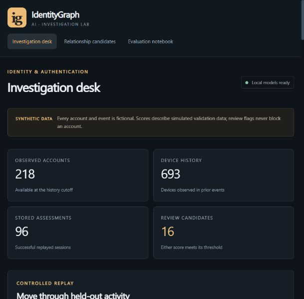

# IdentityGraph AI

[](https://github.com/Dilep01/identitygraph-ai/actions/workflows/checks.yml)

A local research prototype for **simulated account takeover and synthetic identity risk**. It generates fictional accounts and authentication events, maintains point-in-time relationship history, compares conventional and graph models, and provides an investigator interface.

All identities, activity and attacks are simulated. Scores are calibrated, where feasible, against simulated validation data. They are not real-world compromise probabilities. The application never blocks an account or contacts an external service.

Version 1.0 implements the local research project. The final run is `v1` (240 accounts, 6,494 events; seed 907). See the [completion matrix](docs/COMPLETION.md), [verification](docs/BUILD_STATUS.md), and [results and failure cases](docs/RESULTS.md). Relationship-feature LightGBM is served for both tasks. Both held-out takeover families were missed at the selected threshold. Relationship candidates are more selective than the legacy rule, but still include legitimate accounts. The original `release` run is preserved in the development workspace.



The repository contains source, tests, documentation and a [saved results snapshot](docs/reports/v1/README.md). Data, trained model binaries, environments, caches and replay databases are generated locally and are excluded from Git. No external CSVs or API keys are needed for the synthetic project.

## Run on Windows

From PowerShell in this project folder:

```powershell
.\scripts\setup.ps1
.\scripts\build_demo.ps1 -Run v1 -Seed 907
.\scripts\start.ps1
```

Open [the local investigator](http://127.0.0.1:8765). The API reference is at [local API docs](http://127.0.0.1:8765/docs).

The three commands above are for a fresh checkout. If you already built a local run, use only `./scripts/start.ps1`. Setup needs an existing Python 3.11 or 3.12 installation and downloads dependencies into the project cache. It does not change global Python packages. You can pass `-PythonExe 'C:\path\python.exe'` to setup. The full build trains the research comparisons on CPU; completion time depends on the machine.

Builds preserve existing runs. To reproduce the final experiment under a new name, use `./scripts/build_demo.ps1 -Run reproduction01 -Seed 907`. `artifacts/current.json` selects the most recently completed run. The dashboard remains unavailable for scoring until a complete model bundle exists. CLI commands use the current folder as their project root; an installed package also accepts `identitygraph --project-root 'C:\path\identitygraph_ai' serve`.

## What is implemented

- A reproducible simulator with overlapping household/fraud-group sizes, public networks, new phones, changing network addresses, missing attributes, noisy session-binding signals and deliberately difficult unauthorized sessions.
- Physically separate observable and truth datasets; generated actor identity and fraud groups never enter inference features or graph connections.
- Two outputs: unauthorized-actor risk for a successful session and fabricated-identity risk for its claimed account.
- Rules, Logistic Regression, behavioral and relationship LightGBM; Node2Vec with a LightGBM readout; GraphSAGE, RGCN and GAT; device, assurance-signal and relation-type ablations.
- Temporal account-device link prediction, an Isolation Forest anomaly percentile, and attribute-resolution sensitivity experiments.
- Exact and approximate matching of fictional attributes, with evidence retained as candidate relationships rather than automatic identity merges.
- An ordered event replay API and a local investigation dashboard with account search, relationship exploration, candidate clusters, assessments and monitoring.
- SQLite ledgers with duplicate-event handling, saved model versions, history cutoffs, delayed outcome feedback and case export.
- Chronological evaluation, cold-start accounts, new devices, two held-out takeover families, a shifted simulator and two reserved populations.
- Frozen validation distributions for observable drift summaries, a Windows CI configuration, and a separate local IEEE-CIS importer/transaction benchmark command.

The API serves a conventional baseline selected on later validation performance. The representation and GNN models are offline comparisons. Read `artifacts/<run>/models/model_metadata.json` for the selected model. Scores are not a claim that graph learning outperforms conventional methods.

## How a score is produced

The successful login's device, network, region, authentication method and optional pre-decision binding/challenge observations are query context. Historical counts use earlier events only. Failed attempts contribute context but do not receive successful-session takeover scores.

1. Validate the event and look for an existing assessment.
2. Read observable history strictly before the event timestamp.
3. Compute allowlisted features and score both tasks.
4. Persist the assessment and supporting evidence.
5. Add the event to history.

Equal-time events cannot affect one another's history features. Ordered replay requires event time to equal receipt time and rejects late arrivals. Unknown accounts must be registered; unknown devices and networks are supported. Missing models return an explicit unavailable response.

## Graph design

The learning graph has account, device, network and attribute nodes, with relation-specific forward and reverse edges. An account represents a claimed identity; hidden owners are never graph nodes. Sessions are retained in the event ledger and scored as queries instead of accumulating permanent session nodes in the GNN.

The GNNs use daily historical snapshots and current behavioral features. Their graph view can be up to 24 hours old. Baseline relationship features are updated at event time, so this difference matters when interpreting comparisons. Node2Vec freezes its graph after a six-day warmup and uses zero vectors plus flags for unseen entities. The interface bounds the displayed neighborhood; the in-memory history is suitable for this small local dataset.

Candidates require an exact shared email, another shared attribute type, a shared device and different established primary networks. Every pair within a candidate must qualify. Shared networks alone cannot form candidates. Genuine relatives can still qualify; the evaluation reports false positives and wholly missed malicious groups.

## Evaluation and evidence

Default data spans 36 simulated days beginning 2026-01-01. Training ends on January 19; validation ends on January 27. The remaining events are held out. Supervised training and validation respect label availability. The earlier validation block calibrates scores; the later block selects models and thresholds. Test labels are used only for reporting.

The report contains average precision, Brier score, calibration bins, fixed-threshold recall and false-positive rate, false alerts per 1,000 legitimate sessions, precision at a review budget, and account-block bootstrap intervals. Identity metrics use one latest assessment per account. Diagnostic test subsets overlap and must not be added together.

Primary evidence files:

| Location | Contents |
|---|---|
| `data/<run>/manifest.json` | Generator settings, data provenance, split boundaries and checksums |
| `artifacts/<run>/phase_manifest.json` | Completed offline phases and counts |
| `artifacts/<run>/evaluation.json` | Held-out metrics, calibration, clusters and limitations |
| `artifacts/<run>/test_predictions.parquet` | Held-out predictions for independently reproducible metrics |
| `artifacts/<run>/models/` | Fitted baselines, selection policy and validation results |
| `artifacts/<run>/gnn*/` | Four GNN experiments: weights, predictions, cutoffs, calibration and training loss |
| `artifacts/<run>/research/` | Node2Vec, link decoder, anomaly model, ablations and monitoring reference |
| `artifacts/<run>/REPORT.md` | Readable report generated from the saved metrics |
| `artifacts/<run>/checksums.json` | Experiment output integrity manifest |
| `runtime/` | Local replay events, assessments and account registrations |

The shifted dataset changes seed, network/device churn, missing attributes, attribute corruption and attack prevalence. Frozen baselines and GNNs evaluate its own observable history, as well as reserved seeds 1301 and 1709. These remain populations from the same simulator, not independent real-world validation.

## Checks

```powershell
.\scripts\test.ps1
```

Tests cover reproducible generation, truth separation, historical features, future-data invariance, conservative graph linkage, validation-only thresholds, model round trips, failed-model behavior, event idempotency and persistence. The repository includes a Windows CI workflow; a local passing run does not imply that GitHub Actions has run.

The recorded local source suite has 54 passing tests. A [public verification summary](docs/reports/v1/verification.json) and the [build status](docs/BUILD_STATUS.md) describe the exact scope. Full local logs remain under `artifacts/verification/v1/` in the development workspace. GitHub Actions status is shown above and is separate from those recorded local checks.

## Scope and limitations

- One simulator defines both ordinary and malicious activity. High scores on its data do not establish fraud detection in practice.
- Familiar-infrastructure attacks may be indistinguishable from legitimate sessions. Report missed cases rather than forcing all attacks to be detectable.
- Account holdouts can share observable household infrastructure with known accounts. They test unseen accounts, not completely disconnected worlds.
- No real identity verification, KYC integration, authentication provider, payment decisioning, automated blocking or production deployment is included.
- The IEEE-CIS audit/benchmark code is implemented and fixture-tested. Its real transaction and identity CSVs were not supplied, so no external benchmark metrics are reported. See [the import instructions](docs/IEEE_CIS.md).
- Link-prediction metrics use sampled negatives and exclude new nodes. Anomaly and drift scores do not establish fraud or predictive accuracy.
- There is no requirement that graph learning outperform conventional models.

Detailed contracts: [data and time rules](docs/CONTRACTS.md), [graph implementation](docs/GRAPH_DESIGN.md), [models](docs/MODEL_DESIGN.md), and [API](docs/API.md).
